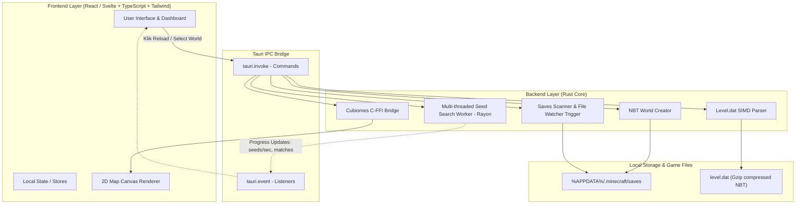

# 01. Arsitektur Aplikasi Tauri (SeedRuns)

Dokumen ini menjelaskan arsitektur sistem **SeedRuns**, pola komunikasi antarkomponen (IPC), dan pembagian tanggung jawab antara **Rust Backend** dan **Web Frontend**.

---

## 1. Diagram Arsitektur Tingkat Tinggi



---

## 2. Tanggung Jawab Komponen

### A. Frontend (UI / Presentation Layer)
- **Teknologi:** React / Svelte, TypeScript, Tailwind CSS, Lucide Icons.
- **Tanggung Jawab:**
  - Menampilkan daftar world yang tersedia beserta thumbnail dan waktu terakhir dimainkan.
  - Menyediakan input kontrol (tombol *Reload*, input radius Nether, tombol *Copy*).
  - Me-render visualisasi 2D map dari koordinat/pixel buffer yang dikirim oleh backend.
  - Menerima event progress streaming dari background worker tanpa membuat antarmuka macet (*non-blocking UI*).

### B. Tauri IPC Bridge
- **Tauri Commands (`invoke`):**
  - `get_save_directories()`: Mendapatkan path folder `.minecraft/saves`.
  - `list_worlds(custom_path?)`: Memindai folder dan mengembalikan daftar ringkasan world.
  - `analyze_world(world_folder_name)`: Membaca `level.dat`, mengambil seed, dan menghitung posisi struktur.
  - `start_seed_search(radius, filters)`: Memulai background search task.
  - `stop_seed_search()`: Mengirim sinyal pembatalan ke background worker.
  - `create_custom_world(world_name, seed)`: Menulis folder world baru.
- **Tauri Events (`emit / listen`):**
  - `seed-search-progress`: Mengirim status pencarian (misal: jumlah seed yang sudah discan per detik).
  - `seed-found`: Mengirim detail seed ketika kriteria radius terpenuhi.

### C. Backend (Rust Layer)
- **Performa Native:** Menangani operasi I/O file, kompresi Gzip, parsing biner NBT, dan interfacing C library.
- **Safety & Concurrency:** Memanfaatkan thread pool `rayon` untuk komputasi berat (seed searching) agar thread utama Tauri tetap bebas melayani UI.

---

## 3. Direktori Proyek Rekomendasi
```text
seedruns/
├── docs/                      # Dokumentasi teknis
├── src/                       # Frontend Web UI (React/Svelte)
│   ├── components/            # Komponen UI (WorldCard, RadarMap, etc.)
│   ├── hooks/                 # Custom hooks / Tauri bindings
│   └── App.tsx / App.svelte
├── src-tauri/                 # Backend Rust
│   ├── c_src/                 # Source code C Cubiomes (cubiomes.c, etc.)
│   ├── src/
│   │   ├── main.rs            # Entry point Tauri
│   │   ├── commands/          # Tauri command handlers
│   │   ├── nbt/               # Parser level.dat
│   │   ├── cubiomes/          # Rust binding untuk Cubiomes
│   │   └── generator/         # Logika pembuatan world baru
│   ├── build.rs               # Build script untuk compile C code
│   └── Cargo.toml
├── package.json
└── README.md
```
