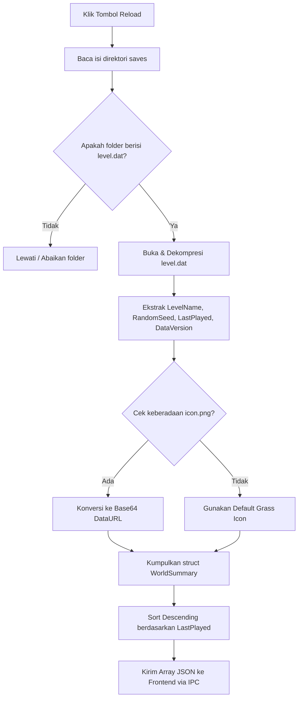

# 02. Spesifikasi Parsing File `level.dat`

Dokumen ini menguraikan struktur data internal Minecraft `level.dat`, mekanisme dekompresi, dan algoritma ekstraksi data penting (Seed, Versi, Timestamp) pada Minecraft versi **1.16.1**.

---

## 1. Lokasi & Karakteristik File

- **Path Standar Windows:** `%APPDATA%\.minecraft\saves\<WorldName>\level.dat`
- **Format File:** NBT (*Named Binary Tag*), dikompresi menggunakan **Gzip** (`.gz`).
- **File Pendukung:**
  - `icon.png`: Gambar 64x64 piksel di root folder world sebagai thumbnail tampilan world.
  - `level.dat_old`: File backup otomatis Minecraft jika `level.dat` corrupt.

---

## 2. Struktur Pohon NBT (Minecraft 1.16.1)

Struktur NBT di dalam file `level.dat` memiliki root tag bertipe Compound bernama `""` (kosong), yang membungkus compound utama bertag `"Data"`:

```text
ROOT (Compound)
└── "Data" (Compound)
    ├── "RandomSeed"       : Long (i64) -> SEED UTAMA DUNIA
    ├── "LevelName"        : String      -> Nama tampilan dunia
    ├── "LastPlayed"       : Long (i64) -> Timestamp Unix (milidetik)
    ├── "DataVersion"      : Int (i32)  -> 2567 (Khusus Minecraft 1.16.1)
    ├── "Version" (Compound)
    │   ├── "Id"           : Int (i32)  -> 2567
    │   ├── "Name"         : String     -> "1.16.1"
    │   └── "Snapshot"     : Byte (i8)  -> 0 (Bukan snapshot)
    ├── "GameType"         : Int (i32)  -> 0 (Survival), 1 (Creative), 2 (Adventure), 3 (Spectator)
    ├── "Difficulty"       : Byte (i8)  -> 0 (Peaceful), 1 (Easy), 2 (Normal), 3 (Hard)
    └── "SpawnX", "SpawnY", "SpawnZ": Int (i32) -> Titik spawn dunia Overworld
```

---

## 3. Strategi Pembacaan Berperforma Tinggi di Rust

Alih-alih menggunakan parser NBT yang memuat seluruh DOM ke dalam tree memory, SeedRuns menggunakan library berbasis **SIMD zero-copy** (`simdnbt`):

1. **Dekompresi Stream:** Membuka file `level.dat` dengan `flate2::read::GzDecoder`.
2. **Selective Parsing:** Mengabaikan tag besar yang tidak relevan (seperti `Player`, `WorldGenSettings.dimensions`, dll.) dan langsung melompat ke offset tag `"RandomSeed"` dan `"LastPlayed"`.
3. **Konversi Tipe Data:**
   - `RandomSeed` disimpan sebagai signed 64-bit integer (`i64`). Nilai ini dikonversi juga ke format string representatif untuk memudahkan copy-paste.
   - `LastPlayed` dikonversi ke format `DateTime<Local>` untuk tampilan waktu di UI.

---

## 4. Algoritma Pemindaian & Sorting World (Manual Reload)

Ketika user menekan tombol **Reload**:



---

## 5. Struktur Data Rust (`WorldSummary`)

```rust
use serde::{Deserialize, Serialize};

#[derive(Debug, Serialize, Deserialize)]
pub struct WorldSummary {
    pub folder_name: String,
    pub display_name: String,
    pub seed: i64,
    pub seed_string: String,
    pub version_name: String,
    pub data_version: i32,
    pub is_1_16_1: bool,
    pub last_played_timestamp: i64,
    pub last_played_formatted: String,
    pub icon_base64: Option<String>,
}
```
