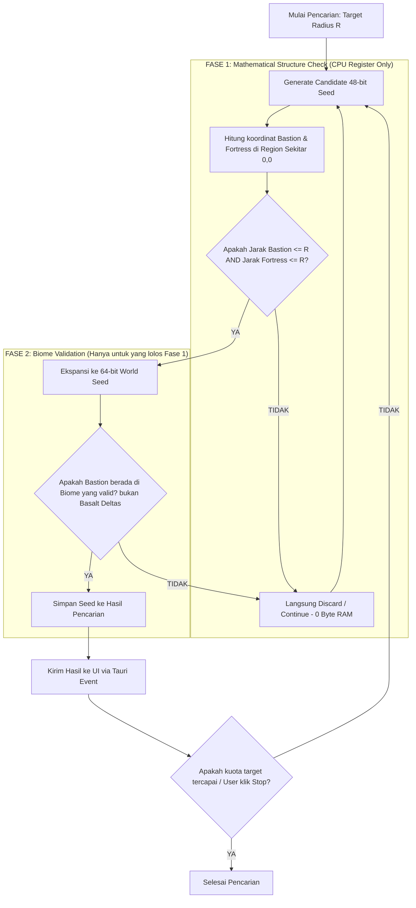

# 04. Algoritma Pencarian & Filter Seed Berkecepatan Tinggi

Dokumen ini mengupas arsitektur algoritma pencarian seed berbasis radius pada **SeedRuns**, strategi optimasi multi-threading, dan eliminasi overhead RAM.

---

## 1. Konsep Dasar Struktur Seed Minecraft (Java 1.16.1)

Setiap seed dunia Minecraft terdiri dari **64-bit integer** ($2^{64}$ kemungkinan kombinasi). 
Namun, posisi penempatan sebagian besar struktur (termasuk Bastion dan Fortress) **hanya ditentukan oleh 48-bit terendah**, yang disebut sebagai **Structure Seed**:

$$\text{Full Seed (64-bit)} = (\text{Upper 16-bit}) \times 2^{48} + \text{Structure Seed (48-bit)}$$

Setiap 1 Structure Seed memiliki **$65.536$ variasi 64-bit Full Seed** yang memiliki posisi koordinat struktur Nether identik, tetapi memiliki sebaran bioma yang sedikit berbeda.

---

## 2. Paradigma Two-Phase Filtering (Zero-RAM Overhead)

Untuk mencegah beban CPU berlebih dan mencegah memory leak saat me-looping jutaan seed, algoritma dibagi menjadi 2 fase:



### Mengapa Nol Kebocoran RAM (Zero-RAM Leak)?
- Pada **Fase 1**, fungsi `getStructurePos` dari Cubiomes hanya melakukan operasi perkalian modulus matematika LCG (*Linear Congruential Generator*).
- Variabel hanya dialokasikan di stack/register CPU (beberapa integer `i32`).
- Jika seed gagal memenuhi kondisi radius, loop langsung meloncat (`continue`) tanpa membuat objek/alokasi heap sama sekali.

---

## 3. Paralelisasi Multi-Threading dengan Rayon

Untuk memanfaatkan seluruh core CPU yang tersedia di laptop/komputer pengguna, pencarian didistribusikan menggunakan thread pool `rayon`:

```rust
use rayon::prelude::*;
use std::sync::atomic::{AtomicBool, AtomicU64, Ordering};
use std::sync::Arc;

pub fn search_seeds_parallel(
    radius_max: f64,
    target_count: usize,
    cancel_flag: Arc<AtomicBool>,
    scanned_counter: Arc<AtomicU64>,
) -> Vec<FoundSeedResult> {
    let results = Arc::new(std::sync::Mutex::new(Vec::new()));

    // Rentang random generator 48-bit
    (0..10_000_000u64)
        .into_par_iter()
        .for_each(|seed_attempt| {
            if cancel_flag.load(Ordering::Relaxed) {
                return;
            }

            scanned_counter.fetch_add(1, Ordering::Relaxed);

            // 1. Cek Cepat Struktur
            if let Some((b_pos, f_pos)) = check_nether_structures(seed_attempt, radius_max) {
                // 2. Cek Validasi Bioma
                if validate_nether_biomes(seed_attempt, b_pos, f_pos) {
                    let mut lock = results.lock().unwrap();
                    if lock.len() < target_count {
                        lock.push(FoundSeedResult {
                            seed: seed_attempt as i64,
                            bastion_pos: b_pos,
                            fortress_pos: f_pos,
                        });
                        if lock.len() >= target_count {
                            cancel_flag.store(true, Ordering::Relaxed);
                        }
                    }
                }
            }
        });

    let final_res = results.lock().unwrap().clone();
    final_res
}
```

---

## 4. Metrik Performa Target

| Konfigurasi Hardware | Throughput Pencarian | Waktu Rata-rata per Seed Bagus (Radius < 150) |
|---|---|---|
| 4 Core / 8 Thread CPU | $\approx 250.000$ seed / detik | $0.8 - 2.5$ detik |
| 8 Core / 16 Thread CPU | $\approx 650.000$ seed / detik | $0.3 - 1.2$ detik |
| Konsumsi Memori (RAM) | $< 45 \text{ MB}$ konstan | Tidak bertambah seiring durasi looping |
